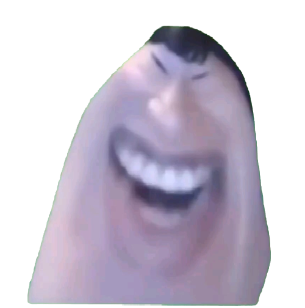

# 说的道理 · Windows 桌宠

> 一张梗图，变成会动、能扔、会反弹的桌面宠物。



## 这是什么

用 WPF 写的轻量 Windows 桌面宠物。它把「说的道理」那张脸做成一个无边框透明窗口贴在桌面上，用像素变形让嘴角自己咧开、脸自己拉长、身子自己摇晃。

不联网、不写注册表、不加开机启动——退出后把文件夹删掉就干净了。

## 功能

- **图片模式（默认）**：没有视频时，用 `original.jpg` 做小幅咧嘴、脸部扭曲、左右摇晃与上下拉伸，无声。
- **视频模式**：拖入绿幕 MP4 后实时扣掉绿色背景，循环播放原片画面与音轨。
- **物理投掷**：快速甩出去会沿抛物线飞出，撞到屏幕边缘或任务栏上方的地面会反弹，下坠越快身体拉得越长。
- **果冻手感**：拎起来会柔软下垂，落地压缩回弹、晃动恢复，撞得越重反应越明显。
- **缩放与节奏**：滚轮调大小（最小 120px），右键可选 0.25×–3× 动作速度。
- **分裂小道理**：右键本体可以分裂，最多同时 10 只，独立拖拽投掷，拖回本体即可合体。
- **记住状态**：位置、大小、音量、视频路径和速度都会写进同目录的 `settings.xml`。

## 快速开始

1. 下载本仓库（`Code → Download ZIP`）或从 Releases 下载压缩包。
2. 解压到任意普通文件夹。**不要单独移动 `DaoliPet.exe`**，它依赖同目录的 `chroma.ps`、`deform.ps` 和 `original.jpg`。
3. 双击 `DaoliPet.exe`。

> exe 没有代码签名，首次运行可能被 SmartScreen 拦一下，点「更多信息 → 仍要运行」。不放心可以自己编译，见下文。

## 操作

| 操作 | 效果 |
| --- | --- |
| 左键按住拖动 | 移动 |
| 快速甩动后松手 | 沿抛物线飞出，撞屏幕边缘或地面反弹 |
| 慢拖、或停一下再松手 | 原地放下 |
| 双击 / 空格 | 暂停 / 继续 |
| 滚轮 | 缩放（最小 120px） |
| 右键 | 音量、静音、大小、载入视频、动作速度、拖拽投掷开关、退出 |
| `M` | 静音 / 恢复 |
| `Esc` | 退出（桌宠获得键盘焦点时） |

## 视频模式（想要原声和原版动作）

图片模式是无声的。要放原版，需要一段**绿幕 MP4**，三种方式任选：

- 直接把 MP4 **拖到桌宠身上**；
- 右键 → **载入原版绿幕视频**；
- 把 MP4 放进 `DaoliPet.exe` 同一文件夹，下次启动自动识别。

推荐 **H.264 + AAC** 的 MP4——播放走 WPF `MediaElement`，依赖系统 Media Foundation，其他编码可能黑屏或没声音。

片源：<https://www.bilibili.com/video/BV1WJ4m1j78r/>

## 从源码构建

需要 Windows 自带的 .NET Framework 4.x（`csc.exe`），不用另外装 SDK：

```powershell
powershell -ExecutionPolicy Bypass -File .\source\build.ps1
```

会在仓库根目录重新生成 `DaoliPet.exe`。

`source/` 里的文件：

- `DaoliPet.cs` —— 主程序（窗口、动画、视频、菜单）
- `ThrowPhysics.cs` —— 投掷与重力反弹
- `PhysicalPose.cs` —— 形变姿态
- `Chroma.hlsl` / `Deform.hlsl` —— 抠绿与形变的像素着色器源码
- `build.ps1` —— 编译脚本

> `chroma.ps`、`deform.ps` 是上面 HLSL 预编译好的像素着色器，运行时由程序加载，必须和 exe 放在一起。

## 素材与声明

- 形象来自网络梗「说的道理」，资料参考：<https://wiki.ottohub.cn/说的道理>
- 原视频：<https://www.bilibili.com/video/BV1WJ4m1j78r/>
- 本仓库只提供桌宠**程序**。梗图、视频和形象的版权归各自原作者，本项目为个人二创，仅供学习娱乐，请勿商用。
- 程序不含网络请求、遥测或开机自启逻辑，代码全在本仓库，可自行审阅。

## License

[MIT](LICENSE)
